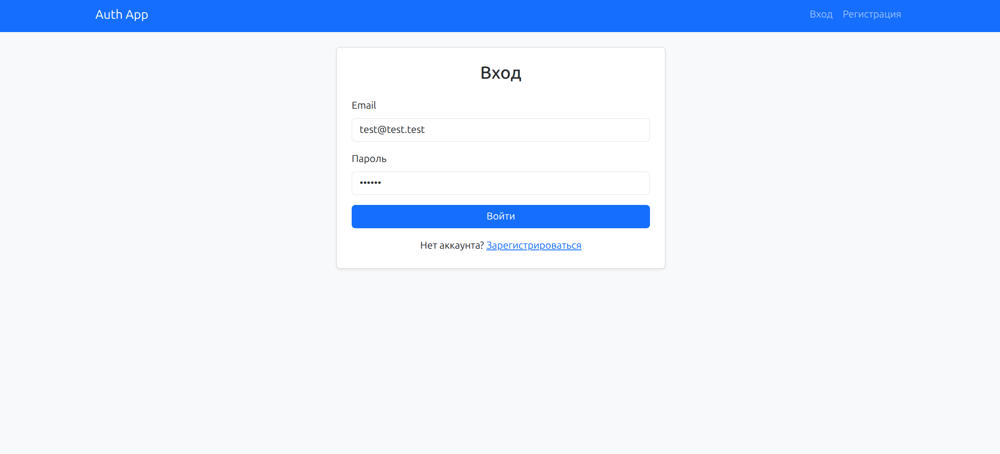
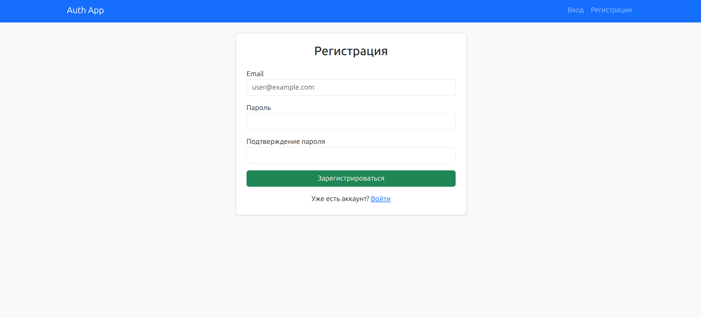
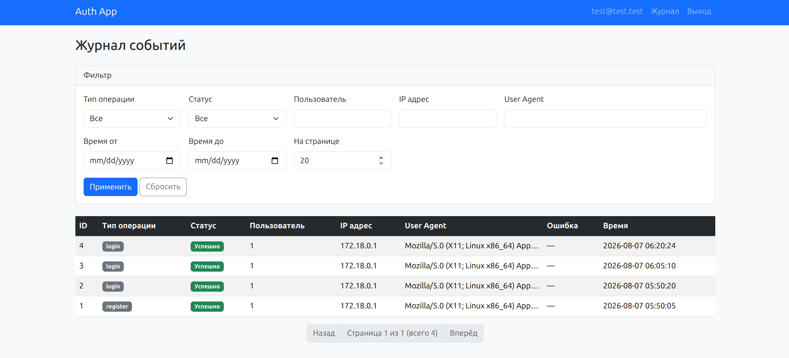

# Cистема регистрации, авторизации и логирования

## 1. Цель проекта

Реализовать систему регистрации и авторизации пользователей по email и паролю с логированием всех попыток входа и регистрации. Доступ к логам ограничен только авторизованными пользователями.

## 2. Используемый стек

| Компонент | Выбор | Обоснование |
|-----------|-------|-------------|
| PHP | 8.3+ (в Docker-образе 8.5) | Современный синтаксис: enum, readonly, атрибуты |
| Symfony | 8.1 (совместим с 7.4 API) | Security Bundle, Form, Validator, Serializer из коробки |
| MySQL | 8.0 | Надёжное хранение, JSON-поле для ролей, индексы |
| Twig | 3.x | Стандартный шаблонизатор Symfony |
| Bootstrap | 5.3 (CDN) | Быстрая адаптивная вёрстка без сборки frontend |
| Docker | dunglas/symfony-docker | Готовая среда: FrankenPHP, Caddy, MySQL |

## 3. Архитектура решения

```
┌─────────────┐     ┌──────────────────┐     ┌─────────────┐
│  Web Forms  │────▶│  Security Layer  │────▶│   MySQL     │
│  /login     │     │  form_login      │     │  user       │
│  /register  │     │  json_login      │     │  auth_log   │
└─────────────┘     └────────┬─────────┘     └─────────────┘
                             │
┌─────────────┐              │              ┌─────────────┐
│  REST API   │──────────────┘              │ AuthLog     │
│  /api/*     │                             │ Service     │
└─────────────┘                             └─────────────┘
```

### 3.1. Два канала аутентификации в одном firewall

**Почему один firewall `main`, а не два отдельных?**

Symfony Security позволяет комбинировать `form_login` и `json_login` в одном firewall. Это даёт:

- единую сессию для web и API (cookie-based auth);
- один `UserProvider` (Doctrine entity);
- общие события `LoginSuccessEvent` / `LoginFailureEvent` для логирования.

Web-форма использует CSRF-токен, JSON API принимает `{"email": "...", "password": "..."}`.

### 3.2. Сущности

**User** — реализует `UserInterface` и `PasswordAuthenticatedUserInterface`:
- email как уникальный идентификатор;
- пароль хешируется через `auto` (Symfony выбирает bcrypt/argon2);
- роли хранятся в JSON, `ROLE_USER` добавляется автоматически.

**AuthLog** — журнал операций:
- `operation_type`: enum `login` | `register`;
- `status`: enum `success` | `error`;
- связь ManyToOne с User (nullable, `ON DELETE SET NULL`);
- ip, user_agent, error_message, created_at.

PHP 8.1+ backed enums (`AuthOperationType`, `AuthStatus`) дают типобезопасность и хранятся в БД как VARCHAR.

### 3.3. Логирование

| Событие | Механизм |
|---------|----------|
| Успешный/неудачный login | `AuthenticationLogSubscriber` на событиях Security |
| Регистрация (API и форма) | явный вызов `AuthLogService` в контроллерах |

**Почему не один middleware?** Регистрация не проходит через Security firewall (публичный маршрут), поэтому для неё нужен явный вызов сервиса. Login унифицирован через Event Subscriber — это стандартный паттерн Symfony.

`AuthLogService` инкапсулирует создание записи: IP из `$request->getClientIp()`, User-Agent из заголовка.

### 3.4. API

| Метод | URL | Описание |
|-------|-----|----------|
| POST | `/api/register` | JSON-регистрация, DTO + Validator |
| POST | `/api/login` | JSON-авторизация (json_login) |
| GET | `/api/logs` | Список логов с пагинацией и фильтрами |

DTO `RegisterRequestDto` с атрибутами `#[MapRequestPayload]` — декларативная валидация без ручного парсинга JSON.

### 3.5. Web-интерфейс

| URL | Описание |
|-----|----------|
| `/register` | Форма Symfony Form с RepeatedType для подтверждения пароля |
| `/login` | Классическая form_login форма с CSRF |
| `/logs` | Таблица логов Bootstrap + фильтры + пагинация |

**Почему Bootstrap через CDN?** Для учебного проекта не требуется Node.js/npm-сборка; Bootstrap 5 даёт готовые компоненты (navbar, card, table, pagination).

### 3.6. Защита маршрутов

```yaml
access_control:
    - { path: ^/api/logs, roles: ROLE_USER }
    - { path: ^/logs, roles: ROLE_USER }
```

Остальные маршруты (`/login`, `/register`, `/api/register`, `/api/login`) публичны.

### 3.7. Пагинация и фильтрация логов

`AuthLogRepository::findPaginated()` использует Doctrine QueryBuilder:

- **Пагинация**: параметры `page` (default 1), `limit` (default 20, max 100).
- **Фильтры** (все поля кроме error_message):
  - `operation_type`, `status` — точное совпадение enum;
  - `user_id` — ID пользователя;
  - `ip`, `user_agent` — LIKE-поиск;
  - `created_at_from`, `created_at_to` — диапазон дат.

Один метод используется и для web (`/logs`), и для API (`/api/logs`) — DRY.

## 4. Запуск и проверка

```bash
# Запуск (если ещё не запущен)
docker compose up -d

# Миграция (если таблицы не созданы)
docker compose exec php php bin/console doctrine:migrations:migrate

# Регистрация через API
curl -sk -X POST https://localhost/api/register \
  -H 'Content-Type: application/json' \
  -d '{"email":"user@example.com","password":"secret123"}'

# Авторизация через API (сохраняет cookie)
curl -sk -c cookies.txt -X POST https://localhost/api/login \
  -H 'Content-Type: application/json' \
  -d '{"email":"user@example.com","password":"secret123"}'

# Просмотр логов (требует авторизации)
curl -sk -b cookies.txt 'https://localhost/api/logs?operation_type=login&page=1'
```

Web-интерфейс: https://localhost/login, https://localhost/register, https://localhost/logs

## 6. Альтернативы, которые были рассмотрены

| Решение | Почему не выбрано |
|---------|-------------------|
| JWT вместо сессий | Избыточно для монолита; сессии проще для web + API в одном приложении |
| LexikJWTAuthenticationBundle | Дополнительная зависимость; не требуется по ТЗ |
| Отдельный frontend (React/Vue) | ТЗ допускает Twig + Bootstrap; меньше сложности |
| Monolog для auth-логов | Нужна структурированная таблица с фильтрацией и пагинацией в UI |
| API Platform | Overkill для 3 endpoint'ов |

## 7. Безопасность

- Пароли хешируются через Symfony PasswordHasher (auto algorithm).
- CSRF-защита на web-форме входа.
- Доступ к логам только для `ROLE_USER`.
- Email валидируется через Symfony Validator.
- Минимальная длина пароля — 6 символов.

## 8. Интерфейс




## 9. Заключение

Решение построено на стандартных компонентах Symfony без лишних абстракций. Единый Security firewall обслуживает и web, и API; логирование централизовано через сервис и event subscriber. Bootstrap обеспечивает современный UI без frontend-сборки. Docker-окружение symfony-docker даёт production-ready стек (FrankenPHP + Caddy + MySQL) из коробки.


# Symfony Docker

A [Docker](https://www.docker.com/)-based installer and runtime for the [Symfony](https://symfony.com) web framework,
with [FrankenPHP](https://frankenphp.dev) and [Caddy](https://caddyserver.com/) inside!

Coding-agents ready: ships with a [Dev Container](https://containers.dev/) and a [one-page guide](docs/agents.md)
to run [OpenCode](https://opencode.ai), [Claude Code](https://claude.ai/claude-code), or any AI coding assistant,
against a local or a remote model, with an optional network sandbox.


## Getting Started

1. If not already done, [install Docker Compose](https://docs.docker.com/compose/install/) (v2.10+)
2. Run `docker compose build --pull --no-cache` to build fresh images
3. Run `docker compose up --wait` to set up and start a fresh Symfony project
4. Open `https://localhost` in your favorite web browser and [accept the auto-generated TLS certificate](https://stackoverflow.com/a/15076602/1352334)
5. Run `docker compose down --remove-orphans` to stop the Docker containers.

## Features

- Production, development and CI ready
- Just 1 service by default
- Super-readable configuration
- Blazing-fast performance thanks to [the worker mode of FrankenPHP](https://frankenphp.dev/docs/worker/)
- [Installation of extra Docker Compose services](docs/extra-services.md) with Symfony Flex
- Automatic HTTPS (in dev and prod)
- HTTP/3 and [Early Hints](https://symfony.com/blog/new-in-symfony-6-3-early-hints) support
- Real-time messaging thanks to a built-in [Mercure hub](https://symfony.com/doc/current/mercure.html)
- [Vulcain](https://vulcain.rocks) support
- Native [XDebug](docs/xdebug.md) integration
- [Hot Reloading](https://frankenphp.dev/docs/hot-reload/)
- [Dev Container](https://containers.dev/) support
- [AI coding agents](docs/agents.md) with an optional network sandbox
- Rootless, slim production image

**Enjoy!**

## Docs

1. [Options available](docs/options.md)
2. [Using Symfony Docker with an existing project](docs/existing-project.md)
3. [Support for extra services](docs/extra-services.md)
4. [Deploying in production](docs/production.md)
5. [Debugging with Xdebug](docs/xdebug.md)
6. [TLS Certificates](docs/tls.md)
7. [Using MySQL instead of PostgreSQL](docs/mysql.md)
8. [Using Alpine Linux instead of Debian](docs/alpine.md)
9. [Using a Makefile](docs/makefile.md)
10. [Updating the template](docs/updating.md)
11. [Troubleshooting](docs/troubleshooting.md)
12. [Using AI coding agents](docs/agents.md)

## License

Symfony Docker is available under the MIT License.

## Credits

Created by [Kévin Dunglas](https://dunglas.dev), co-maintained by [Maxime Helias](https://twitter.com/maxhelias) and sponsored by [Les-Tilleuls.coop](https://les-tilleuls.coop).
